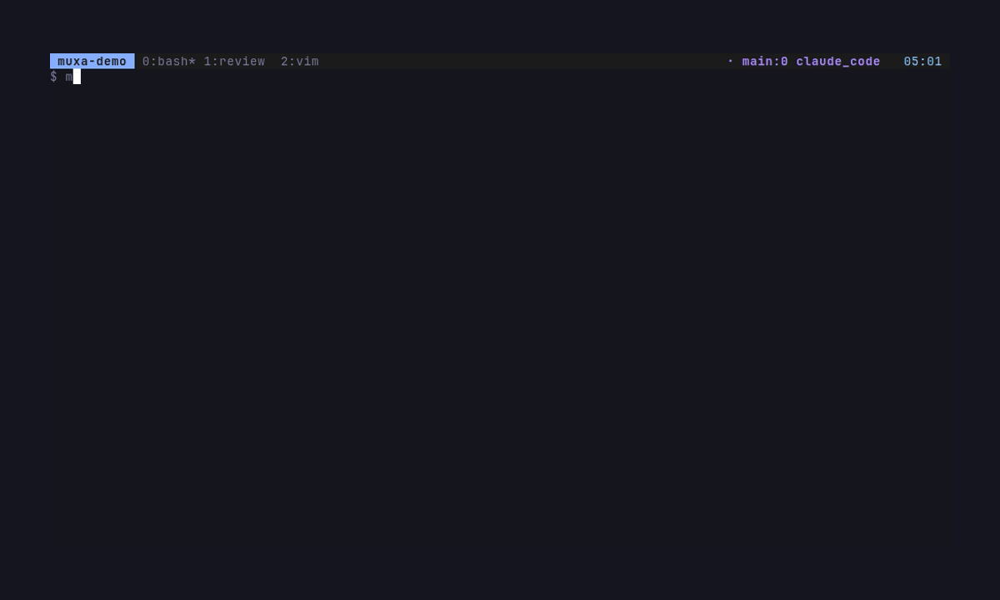
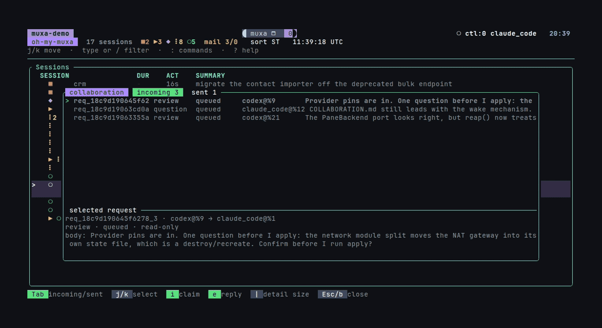

<div align="center">


**The operations platform for your team of coding agents.**

See which agent is waiting on you and jump to it — then run the whole team as
Work: launch agents, let them review each other, and follow them across hosts.
Start with zero setup on the Claude Code, Codex, and Antigravity CLI sessions you
already run in tmux; let Tend launch and own agents when you want more.

[](https://github.com/Open330/tend/actions/workflows/ci.yml)


[Try tend](https://open330.github.io/tend/learn/) · [Website](https://open330.github.io/tend/) · **English** · [한국어](README.ko.md)

</div>

---

> [!NOTE]
> **Muxa is now Tend.** Coming from Muxa? Move your install over with
> `scripts/migrate-from-muxa.py`. See [docs/MIGRATING_FROM_MUXA.md](docs/MIGRATING_FROM_MUXA.md).

## Try tend

[Try tend in your browser](https://open330.github.io/tend/learn/) before installing.
Type directly in the terminal and follow one key at a time.

| Start here | What you can try |
| --- | --- |
| [tmux basics](https://open330.github.io/tend/learn/?track=basics) | Attach to a prepared session from a normal shell, learn session → window → pane, move and zoom panes, and switch windows. |
| [Watch and collaboration](https://open330.github.io/tend/learn/?track=attention) | Answer a waiting agent, request a review, and read the reply in the mailbox. |
| [Workspace navigation](https://open330.github.io/tend/learn/?track=workspace) | Browse and search the watch tree to connect to sessions, windows, and panes. |
| [Inspect a screen](https://open330.github.io/tend/learn/?track=inspect) | Use previews, raw terminal output, inspector sizing, and help. |
| [Free exploration](https://open330.github.io/tend/learn/?track=free) | Explore several sessions and windows with the shortcut reference alongside. |

When a continue action appears, press **Alt + Enter** (Option + Return on Mac)
to advance without clicking. Switching guides keeps the same terminal and
request history. This is a browser-local simulation; it runs no real shell commands or agent API calls.
For practice in real tmux, install Tend and use `tend onboard` below.

## Get started

Requires tmux 3.x (or herdr) and a Unix-like OS.

```bash
brew install open330/tap/tend
tend           # view existing agents, start one here, or try the demo
```

<div align="center">
  
  <br />
  <sub><code>tend watch</code> — the fleet, the inspector, the swarm view, and <code>tend attend</code>.</sub>
</div>

`tend` opens watch directly when agents are already tracked. Otherwise, choose
an installed agent to start in the current folder, view existing terminals, or
try the demo. Starting an agent previews and backs up the hook/tmux changes;
cancelling setup also cancels the launch. MCP is not required.

Try the core workflow outside tmux:

```bash
tend onboard --quick
```

The three-step demo prepares practice agents, then lets you open watch, inspect
their states, and attend the waiting agent. It makes no agent API calls and
removes its private sandbox on exit. `tend onboard` keeps the full 16-step tour;
`tend onboard --quick --print` shows the short written guide.

To try the actual CLI without installing it, take the full tour in a throwaway
tmux server. The script runs the real `tend onboard` from a checksum-verified copy of the
release binary, deletes it on exit, and never touches your existing tmux
server. It needs network access and a supported release platform; the live
tour also needs tmux. `tend onboard --print` gives a non-interactive guide.

```bash
curl -fsSL https://raw.githubusercontent.com/Open330/tend/main/scripts/onboard.sh | sh
```

## Why tend

Tend has two layers. **Attention** works on agents you already run; **Runtime**
organizes the agents Tend launches into Work. Attention never requires Runtime.
See [Direction](docs/DIRECTION.md).

- **Keeps your setup.** Reads agent state from Claude Code, Codex, and
  Antigravity CLI (`agy`) hooks and opencode plugin events, with screen detection
  for hook-less agents, and maps it onto the tmux panes you already have.
  You can keep launching agents yourself, or use tend's optional agent and
  pipeline launchers. tmux, [rmux](https://rmux.io),
  and [herdr](https://herdr.dev) can be observed at the same time; zellij
  has a CLI baseline.
- **Tells you who is waiting.** tmux status line, the `tend watch` TUI,
  and desktop notifications.
- **Takes you there.** `tend attend` focuses the pane blocked longest;
  `--cycle` tabs through every agent that needs you.
- **Keeps reviews and replies together.** Press `m` in watch to send a peer
  request, then `M` to read requests and replies in the mailbox.
- **Lets one agent drive the rest.** `tend mcp` gives a coding agent the
  same view, plus send-prompt and wait-for-change tools.

> [!IMPORTANT]
> Beta. Event ingest, the daemon, CLI, live TUI, desktop notifications,
> stats, and reports work end-to-end, but APIs may still change before 1.0.

## What You Get

| Surface | What it does |
| --- | --- |
| `tend status-line` | One-line tmux `status-right` summary for the active pane. |
| `tend peek` | `prefix + q` overlay: each pane's live screen dimmed under a box with its handle (`@claude`) and tmux pane id, its agent's state, summary, and latest prompt/response; a separate Links panel below shows roles, primary/worker purpose and request/reply state, with full pane IDs and connecting arrows following the real pane layout — including how long ago you last prompted it and which pane was prompted most recently; press a digit to jump, or `|` for a scrollable reader (`Tab` toggles terminal history). |
| `tend sidebar show` | Persistent left/right agent explorer, with matching pane colors and sidebar-aware focus zoom. [Usage](docs/SIDEBAR.md). |
| `tend watch` | Main TUI for agents, prompts, live previews, hierarchy-aware mailbox history, and table/sequence collaboration. |
| `tend dashboard` | `tend watch` on its Work board: Works first, `P` prompts and `A` interrupts every live agent of the selected Work. |
| `tend attend` | Jump to the agent blocked on input/choice/error longest. |
| `tend stats` / `tend stats report` | Local analytics for prompt history, agent state duration, tmux foreground time, and human thinking time. |
| `tend timeline` | Full-screen TUI timeline of agent work, waiting, errors, human interaction, and tmux foreground time. |
| `tend stats activity` | Raw duration ledger query for debugging exactly what fed stats/report. |
| `tend automation` | Rules that act on agent state — the built-in one resumes a session after its usage cap resets. |
| `tend swap` | Restart agents on their own accounts with `--all --to same --when-idle`, or move agents onto another account (configured accounts, or the optional `aas` provider) and resume them in place — the rate-limited ones, named panes, or all. Part of the optional account module (`[modules] accounts`, on when your config already uses accounts). See [docs/ACCOUNT_SWAP.md](docs/ACCOUNT_SWAP.md). |
| Tend for Mac | Native app that opens on Home (Work units in Your turn / In progress / Finished lanes), plus Explore, Inbox, Ask, Shells, and Files, with a libghostty terminal and notifications; native PTYs remain owned by `tendd`. |
| Dashboard | Optional loopback HTTP UI with live updates, timeline, and collaboration graphs; the bearer token is its only credential. |
| Notifications | Optional desktop alerts when agents need attention. |

## More install options

Homebrew (above) is the main path. For the Mac app (notarized, updates
through Homebrew since it has no built-in updater):

```bash
brew install --cask open330/tap/tend-app
```

Or the one-shot installer (builds from source, requires Rust 1.89+):

```bash
curl -fsSL https://raw.githubusercontent.com/Open330/tend/main/scripts/install.sh | sh
```

Or from source:

```bash
git clone https://github.com/Open330/tend.git
cd tend
cargo install --path crates/tendd --locked
cargo install --path crates/tend-cli --locked
tend init
```

Verify:

```bash
tend daemon start
tend daemon status
tend status
tend watch
```

### Build Tend for Mac

The native macOS app embeds a libghostty terminal while keeping shells and
agents in `tendd`, so closing the app does not stop them. Ghostty, its Swift
surface, and the required Zig compiler are pinned and verified; Tend builds its
own local XCFramework instead of consuming a prebuilt terminal binary.

```bash
brew install xcodegen
apps/tend-macos/Scripts/build-app.sh --open
```

After building, run `apps/tend-macos/Scripts/smoke-test.sh` for a
non-interactive product smoke test.

See [Tend for Mac](docs/MACOS.md) for the architecture, build inputs, and IPC
contract.

## Organize work in tmux

Optional: you can keep using your own tmux layout. If you want tend to manage
where agents run as well, it gives tmux a work model.

Tend treats tmux as a work execution adapter, not just a collection of terminal
panes. The durable logical model is Workspace → Work → Run → Agent session:

| tmux object | Tend meaning | How it is used |
| --- | --- | --- |
| **session** | Workspace execution context | Contains active Run windows for one managed workspace. |
| **window** | One active Work Run | Carries a link to stable Work identity and cwd; closing it ends the Run. |
| **pane** | Agent execution surface | Binds an implementer, reviewer, or helper Agent session to that Run. |

The intended workflow is equally direct:

1. Start a work ID once; Tend creates or reuses the workspace session, creates
   its work window, and starts the first agent pane.
2. Add implementer, reviewer, or helper agents as additional panes in that
   Work Run. Other Work items use sibling Run windows.
3. Observe, preview, message, and control those agents through `tend watch`,
   or let an agent use the same policy through `tend mcp`.
4. Close an agent pane, work window, or whole workspace session explicitly.
   Tend refuses to terminate unmanaged tmux objects.

An optional Linear/GitHub/Jira issue is a reference attached to Work, not the
Work identity or local board stage. See [the Work domain model](docs/WORK_MODEL.md).
In short: **Workspace → Work → Run → Agent session**, with tmux as the current
binding. Run `tend onboard` for one continuous safe scenario.
It creates a private throwaway tmux server, daemon, and mailbox, then lets you
type `tmux new-session`, see the hierarchy, prove detach/attach persistence,
start sandboxed agents, and use the real Tend watch, attend, and messaging
workflow. It never touches your existing tmux server and removes the sandbox on
exit.

### Clear a stale agent record

Reinstalling Tend preserves its registry. A cmux record can outlive the agent
because cmux observation is partial; an unseen surface does not prove an exit.
`tend registry prune` only removes orphan rows without a pane, surface, or pid.
For a stale record that still carries a pane, find its `agent_session_id` in
`tend status --json`, then run:

```sh
tend registry forget <agent_session_id>
# Add --yes to skip the confirmation.
```

This removes exactly one registry row without stopping its process or terminal.
Later hooks or scans may register an active agent again. Prompt history is kept.

### Ask for human attention

An agent can run `tend msg attention "Approve staging deployment?" --action approval`,
or use the `tend_request_attention` MCP tool. Required approval, choice, and
information requests appear in Tend for Mac's Attention, Inbox, Dock badge, and
notifications across connected Fleet hosts. A response on one client resolves
the same durable request on other connected clients. See [Fleet setup](docs/FLEET.md#human-attention-across-clients).

### Collaborate from `tend watch`

<div align="center">
  
  <br />
  <sub><code>M</code> mailbox · <code>m</code> message the row under the cursor · <code>a</code>/<code>A</code> headless ask.</sub>
</div>

The model is simple: **one tmux window is one room**. Interactive watch and
dashboard messages are sent by the operator console, so either popup can be
opened from an agent or a spare shell pane. Agent-initiated MCP and `tend msg`
requests still use that agent's pane identity.

One-time setup: add the following to `~/.config/tend/config.toml`, restart
`tendd`, and run `tend init` to install the `prefix+s` watch popup.

```toml
[collaboration]
enabled = true
wake = "idle_only"
# Default: deliver operator messages directly; keep agent messages as notices.
wake_payload = "operator_full"
```

Install shared collaboration instructions, the symlinked skill, and MCP for
detected Codex and Claude Code installations, then restart running agents.
The standard preset includes this setup.

```bash
tend init --component agent-instructions,agent-skills,agent-mcp
```

Init adds Codex's required pane environment forwarding to `[mcp_servers.tend]`
while preserving existing variables and other settings:

```toml
env_vars = ["RMUX", "RMUX_PANE", "TMUX", "TMUX_PANE", "TEND_SOCKET"]
```

Tend also recovers the pane from process ancestry across active pane backends
for existing default-endpoint Codex registrations, so older setups fail safely
rather than appearing paneless.

See [Global agent integration](docs/AGENT_INTEGRATION.md) for canonical paths,
updates, and removal; [MCP setup](docs/MCP.md) also covers manual registration.

Connected agents are told that room peers can serve as read-only reviewers or
narrowly scoped execution subagents.

You can call a colleague directly from a connected Claude or Codex
conversation. The agent maps the mention to Tend's durable peer-call tool:

```text
@peer review the current changes
@codex /review-plan-feedback using commit abc123 as context
@peer's report: summarize it and apply only valid advice
```

`@peer` and `@tend-peer` are reserved for Tend collaboration. New requests use
the peer-call tool; references to an existing peer report use the durable
mailbox report tool and never imply a GitHub PR without an explicit PR reference.
`@peer` chooses a healthy same-window agent deterministically; `@claude`,
`@codex`, `@agy`, `@alias`, and `role:name` narrow the target. Calls default
to `REVIEW · READ-ONLY`. Executing changes requires an explicit task
authorization, and creating a new agent pane requires a separate confirmation.
Restart an already-running agent after upgrading Tend or changing registered
skills so its MCP process loads the new tool and templates.

Agents reported as synthetic by `tend doctor` are omitted from collaboration
until a hook event establishes a stable session identity. Submit a prompt or
restart that agent, then check again.

Then:

1. Run two agents in two panes of the same tmux window.
2. Press `prefix+s` from any pane and select the recipient's session, window,
   or pane. Parent rows resolve to the lowest numeric live agent and show the
   exact target in the composer title.
3. Press `m`, type the request, and press `Enter`. At any point in the draft,
   `/` opens reusable skills registered with `tend skill add`; selection inserts
   at the cursor and a second `Enter` sends. Press `M` to read and reply from
   the mailbox.

Press `prefix+M` from an agent pane, or `Alt-M` on its row in local watch, to
move it into a new session/window or an existing window without restarting.
The shared menu supports destination search, follow/stay, split direction,
and undo. On a window row, `Alt-M` moves every pane and the layout together;
`Ctrl-W` in the popup switches pane/window scope. See [moving a running agent](docs/WATCH.md#move-a-running-agent).

The default tmux prefix is **Ctrl and b together, then release both keys**.
Press `s` next to open watch. Inside watch, use these keys without the prefix:

| Key | Action |
| --- | --- |
| `j` / `↓`, `k` / `↑` | Select the next / previous item |
| `h` / `l`, `←` / `→` | Move to a parent or child |
| `/` | Search agents and workspaces |
| `Enter` | Connect to the selected target |
| `o` | Preview the selected pane |
| `m` | Compose a message |
| `M` | Open the mailbox |
| `?` | Show all keyboard shortcuts |
| `q` | Close watch and return to the original pane |

`M` on a window combines its room; on a session it combines all windows and
groups the read-only history by window. On the collaboration screen, `v`
toggles the newest-first table and chronological sequence (`tend watch
--screen collab --collab-layout sequence` starts there directly). The web
dashboard adds a cross-room node-edge graph, sequence drill-down, filters, and
cursor pagination. Durable history is indexed in `collaboration.sqlite3`; an
existing `collaboration.json` is imported once and retained as a migration
backup until you remove or archive that duplicate copy.

For request/reply details, see
[docs/COLLABORATION.md](docs/COLLABORATION.md); for skill registration and
composer controls, see [docs/WATCH.md](docs/WATCH.md).

For install modes, `tend init` presets, systemd, manual hook wiring, and
rollback details, see [docs/INSTALL.md](docs/INSTALL.md).

## Core Commands

Managed tmux policy binds a workspace context to a session, an active Work Run
to a window, and an Agent session to a pane. `tend onboard` teaches that mapping
in sixteen live steps on a private sandbox. You create a real session and
window, inspect the tree, detach and reattach, split a pane and let the tour
bring up two scripted agents, then use real `tend watch` — including the
`j`/`k`, `Enter` and `?` keys it is driven with — `tend attend`, and `tend msg`
against a real sandbox mailbox. The narration observes tmux and Tend state; it
does not intercept your keys. Korean is selected automatically for a Korean
locale, can be requested with `--lang ko`, and can be toggled with `F2` during
the tour. `--print` emits the same sixteen-step workflow without starting tmux.

| Command | Purpose |
| --- | --- |
| `tend status [--flat\|--json]` | Agents as a session / window / pane tree (`--flat`: one row per agent), or a versioned JSON snapshot for desktop integrations. |
| `tend watch [--view session\|window\|pane]` | Live workspace → work → agent TUI picker/dashboard. |
| `tend dashboard [--since today]` | The watch Work board: per-agent and Work-wide prompt/interrupt, messages and mailbox as an agent, collaboration counts, and an ACT/WACT summary. |
| `tend attend [--cycle] [--list]` | Focus or list agents needing attention. |
| `tend status-line [--pane %N]` | tmux status-line output. |
| `tend peek [--plain] [--expanded]` | Per-pane overlay for the current tmux window; `--plain` prints it as text. The overlay is a tmux popup, so where nothing can draw one — a front-end that attaches no client (cmux), or a control-mode client (`tmux -CC` — amux, iTerm2) — peek prints the text report instead and says why on stderr. |
| `tend recap [--pane %N]` | Recent prompts from retained disk history. |
| `tend agent search 'question'` / `tend agent read EVENT_ID` | Search historical Claude/Codex conversations and commands with a Korean/English question, then inspect surrounding evidence and paired tool results. [Guide](docs/AGENT_RECORDS.md). |
| `tend peers` / `tend identity` / `tend msg` | Discover and name same-window agents, then exchange durable request/reply messages. |
| `tend workers [--idle-hours N] [--json]` | List every worker tend launched for peer work, across all rooms: state, observed idle time, open requests, and flags (`error` = never reused, so a replacement may be spawned; `long-idle`; `possible-overlap`, informational). Read-only; only sessions positively known to be workers are listed. It also lists launches still holding capacity without a registered worker; `tend workers release <launch-id> --reason <why>` frees an uncertain one after you check its launcher stopped (refused while a live process still matches; audited; never stops a process). `tend doctor` summarises the same findings. |
| `tend skill add/list/show/remove` | Manage reusable `/` prompt templates for watch/dashboard messages, watch ask, and MCP peer calls. |
| `tend fleet host add/list/label/annotate/doctor` | Manage physical SSH nodes and Kubernetes-style labels/annotations. |
| `tend fleet status/watch/capture/send/attach` | Central host → session → window → pane(agent) observation and control. |
| `tend stats --since today` | Focused WACT/ACT/WORK/WAIT summary; group by day/project/agent/session. Add `--graph` for graph-only WACT over time or `--verbose` for diagnostic columns. |
| `tend stats report --since week` | All breakdowns (day/project/agent/session) as focused ACT/WACT tables; add `--json` or `--markdown` to export. |
| `tend timeline --since today` | Interactive session-grouped timeline; filter with `--session main` / `--agent codex`, sort with `--sort waiting`, or use `--view heatmap`. |
| `tend stats activity --type agent\|tmux\|human` | Raw activity ledger intervals. |
| `tend registry sync` / `prune` / `forget` / `panes` | Backfill the registry, drop orphan rows, forget an exact agent session, or list pane hosts. |
| `tend proc register --name X [--pid N]` | Surface an arbitrary background process (script, game, automation loop) as a pid-tracked row in `tend status`. |
| `tend proc run --detach --name X -- <cmd>` | Run a command in a tend-owned PTY; it also appears in `tend status` as a task. `tend proc attach/detach X` reconnects or leaves it. |
| `tend agent start --agent codex [--host auto\|native\|tmux]` | Start an allowlisted agent. `auto` uses tmux inside tmux and a tend-owned PTY in a plain terminal. |
| `tend work init` | Describe a work pipeline in your own words; an agent writes the `[ticket]`/`[[route]]`/`[pipeline.*]` config, validated and shown before anything is written. |
| `tend work compose "implementer in claude, reviewer in codex after it"` | Draft one pipeline from a description without writing anything: the reply is the same JSON `tend work pipeline set --from-json` accepts, validated like it, so Tend.app can show it for review first. |
| `tend ask providers` / `tend ask provider add anthropic-work --engine anthropic` / `tend ask provider use codex` | List the Ask providers with what each needs, and compose the list: an instance names its engine (Claude Code, Codex, Gemini CLIs; Anthropic, OpenAI APIs; Apple Intelligence on a Mac, with no key), its model, and its own key variable, so several keys for one engine can coexist. `use` makes one the default and saves it as `[ask] agent`. |
| `tend automation list` / `tend automation test resume-after-limit` | Inspect the rule engine and see what a rule would do right now without firing it. A rule reacts to an agent event (a session limit, a wait for input, an idle stretch) after a delay, with guards that a rule cannot opt out of. See [docs/AUTOMATION.md](docs/AUTOMATION.md). |
| `tend config show` / `tend config set --from new.toml` | Read and replace the daemon's `config.toml` through tendd, which parses and validates before writing. Tend.app's Settings › Advanced edits the same file the same way. |
| `tend work preset apply solo --route '.*'` | Write a built-in pipeline (`solo`, `pair`, `triad`) into `config.toml` without an agent turn; `tend work options --json` prints the routes, pipelines, skills, and presets a launcher can offer. |
| `tend work up eng-1234 --body "..."` | Resolve the ticket, route it to a workspace, and create whichever pipeline agent panes are missing — delivering the request to the ones already running. Re-running converges; also `tend_start_work` over MCP. See [docs/PIPELINE.md](docs/PIPELINE.md). |
| `tend work start tend-onboarding --workspace tend --agent codex ...` | Create/reuse workspace session `tend`, create/reuse its work window, and add an agent pane. |
| `tend workspace list/show/view/close` | Inspect, give the current terminal an independent grouped view of, or explicitly close workspace/project sessions. |
| `tend window rename NAME` | Give a tmux window a stable normalized name, or restore process-based naming with `--auto`. |
| `tend work list/show/close [--workspace tend]` | Inspect Work and its current Run binding, or explicitly close that Run window. |
| `tend agent start --host tmux --workspace tend --work tend-onboarding ...` | Add an allowlisted agent pane to one managed tmux Work window; also exposed as MCP `tend_start_agent`. |
| `tend agent control (--pane %N\|--session pty-N) --action interrupt` | Interrupt or explicitly terminate one managed tmux pane or tend-owned PTY agent session. |
| `tend onboard [--tour live] [--lang auto\|en\|ko]` | Sixteen live steps on a throwaway tend: real tmux, watch, attend, and mailbox. Refuses to nest inside an existing tmux session. `F2` switches language, `--no-quiz` offers `F12` immediately, and `--print` emits the written guide. |
| `tend automation list/test/log` | Rules that watch agent state and act on it — resume a session once its usage cap resets, nudge an idle agent, interrupt a stuck one. Ships enabled with no rules; `pause`, `cooldown`, per-rule hourly caps, a fire-time re-check, and a durable ledger keep it from running away. See [docs/AUTOMATION.md](docs/AUTOMATION.md). |
| `tend mcp` | MCP stdio server so a coding agent can orchestrate tend — inspect agents, send prompts, capture panes, wait for changes (`claude mcp add --scope user tend -- tend mcp`, see [docs/MCP.md](docs/MCP.md)). |
| `tend snapshot` | Capture this multiplexer's workspace — sessions, windows, panes, geometry, working directories, each pane's own command line, and tend's Work, workspace and role/task/alias marks — into `$XDG_DATA_HOME/tend/snapshots`. |
| `tend restore [DIR] [--run]` | Rebuild a workspace from a snapshot, marks included: sessions and windows it creates get their workspace and Work back and their panes their role, task and alias (never a worker grant, never on top of marks a target already has, and never onto a session that was already there). Prints the plan unless `--run`, because restoring into a server that still has those sessions adds panes rather than replacing them. `--boot` is the login-hook form: it restores only into a server with no sessions, starting it if needed — `tend init --component restore-at-login` registers it with systemd, launchd or Task Scheduler. |
| `tend reload mcp [--codex-home DIR]` | Ask the existing Codex app-server to refresh all configured MCP connections for that profile. It reports queued acceptance and connection verification; exit 2 means refresh is pending, unverified, or still needs a client-side reconnect it lists (a standalone Codex CLI is named with its session id to resume). It does not restart panes or app-server. `--all` targets discovered stale shared Codex profiles; `--dry-run` previews scope. |
| `tend reload mux [--snapshot DIR]` | Explicit name for the full multiplexer reload below. |
| `tend reload [--snapshot DIR]` | Snapshot, restart the multiplexer, and put the workspace back — the way to pick up a new tmux/rmux build without rebuilding thirty panes by hand. Run it from outside the server it restarts; a pane tend tracked comes back on its own conversation, and an agent the reload cut off mid-turn is sent `continue` once it has resumed (`--continue TEXT` to change it, `--no-continue` to skip). |
| `tend init` | Interactive install/uninstall wizard. |
| `tendd` | Daemon process. |

Common stats queries:

```bash
tend stats --since today --group-by session
tend stats --since yesterday --group-by project
tend stats report --since last-week
tend timeline --since today --session main
tend timeline --since today --exclude-session 'monitor*'
tend stats --since month --exclude-pane '%42' --exclude-session 'monitor*'
tend timeline --since today --group-by kind --sort waiting
tend timeline --view heatmap --since 12w
tend timeline --day 2026-06-06
tend stats activity --since today --type human
```

`--since` accepts `today`, `yesterday`, `week` for a rolling 7-day window,
`month` for a rolling 30-day window, `last-week` / `"last week"` for the
previous Monday-Sunday calendar week, `last-month` / `"last month"` for the
previous calendar month, rolling durations like `24h`/`7d`/`4w`, local dates
like `2026-06-06`, RFC3339 timestamps, and `all`. See
[docs/ACTIVITY.md](docs/ACTIVITY.md) for ledger semantics, including
`HUMAN`, `THINK`, and `ACT`.

`tend stats`, `tend stats report`, and `tend timeline` also accept
`--exclude-pane` and `--exclude-session` for long-lived monitoring scopes.
Patterns are case-sensitive and support `*` and `?`, e.g.
`--exclude-session 'monitor*'`.

## Supported Agents

**Hook-based (authoritative).** These wire into their existing hook/event
systems, so tend gets exact state transitions:

| Agent | Status | Config |
| --- | --- | --- |
| Claude Code | Supported | `~/.claude/settings.json` |
| OpenAI Codex | Supported | `~/.codex/config.toml` |
| Google Antigravity CLI (`agy`) | Supported | `~/.gemini/config/hooks.json` — [details](docs/ANTIGRAVITY.md) |
| opencode | Supported (plugin events) | `~/.config/opencode/plugins/tend.ts` — [details](docs/OPENCODE.md) |

The Google Gemini CLI is no longer supported; use its successor, the
Antigravity CLI. `tend init` removes the hooks an older tend wrote into
`~/.gemini/settings.json`, and `tend doctor` points out any that remain.

The daemon also reads Codex session-rollout logs every two seconds to recover activity and
turn completion when hooks miss an update. Quota percentages and credits are
telemetry; an actual limit failure is needed before showing a quota error.

**Screen-detected (fallback).** Agents with no hooks are classified from
their pane contents via TOML manifests — bundled for `agy`, `codex`, `cursor-agent`,
`amp`, `copilot`, `aider`, and `goose`, extensible per user. Hooks win when
present, with one carve-out: `agy` fires no hook for an approval prompt, so its
panes stay screen-inferred for that one signal. See
[docs/SCREEN_DETECTION.md](docs/SCREEN_DETECTION.md).

On [herdr](https://herdr.dev) hosts, tend additionally surfaces every
agent herdr's own detection sees, with no manifest needed.

## Fleet Hosts

Run tendd locally as a central controller for this machine and several
SSH-reachable machines. The controller appears immediately as the `local`
node, without Fleet configuration. Each physical node keeps its own stable UUID and label/annotation metadata;
the controller maintains one persistent outbound SSH stdio relay and an
independent last-known cache per node. `observe` is the default, while
`control` must be granted per host. No remote TCP listener is opened.

```bash
tend fleet status                         # local is already present
tend fleet status -L environment,region   # opt-in label columns
tend fleet status -o wide                 # hostname/version/latency when space permits
tend fleet host label local environment=development
tend fleet host add dev tend-devbox --label environment=development --mode observe
tend fleet host doctor dev
tend fleet watch
# equivalent entry point: tend watch --fleet
# `tend init` also binds this view to tmux prefix+S (local watch stays prefix+s)
# with only local, this is the full native watch with no redundant host row
```

See [docs/FLEET.md](docs/FLEET.md) for selectors, TUI controls, security,
performance, MCP tools, and dashboard APIs.

## Pane Backends

tend observes agents across terminal-multiplexer backends and can watch
several at once (e.g. during a tmux→herdr migration):

| Host | Status | Notes |
| --- | --- | --- |
| tmux | Full | The default backend. |
| [rmux](https://rmux.io) | Initial CLI backend | Pane discovery, capture, focus, and targeted input; see [docs/RMUX.md](docs/RMUX.md). The host on native Windows — see [docs/WINDOWS.md](docs/WINDOWS.md). |
| [herdr](https://herdr.dev) | Full | Via herdr's socket API; see [docs/HERDR.md](docs/HERDR.md). |
| cmux | Labs (adopt-only) | Identifies the current surface from hook env, focuses it and sends targeted text; no full inventory, pid map or capture. See [docs/CMUX.md](docs/CMUX.md). |
| zellij | Labs (adopt-only) | Observes hooked panes and jumps to them; no capture or send. The planned WASM plugin was dropped. |

See [docs/MULTI_HOST.md](docs/MULTI_HOST.md) for observing multiple hosts
simultaneously.

## More Docs

| Topic | Doc |
| --- | --- |
| Install and wiring | [docs/INSTALL.md](docs/INSTALL.md) |
| Onboarding and work/agent policy (한국어) | [docs/ONBOARDING.ko.md](docs/ONBOARDING.ko.md) |
| Work pipelines (`tend work up`) | [docs/PIPELINE.md](docs/PIPELINE.md) · [한국어](docs/PIPELINE.ko.md) |
| MCP control plane (`tend mcp`) | [docs/MCP.md](docs/MCP.md) |
| herdr host support | [docs/HERDR.md](docs/HERDR.md) |
| rmux host support | [docs/RMUX.md](docs/RMUX.md) |
| Native Windows (PowerShell + rmux) | [docs/WINDOWS.md](docs/WINDOWS.md) |
| Multi-host observation | [docs/MULTI_HOST.md](docs/MULTI_HOST.md) |
| Physical SSH fleet | [docs/FLEET.md](docs/FLEET.md) |
| Antigravity CLI (`agy`) support | [docs/ANTIGRAVITY.md](docs/ANTIGRAVITY.md) |
| Screen-manifest detection | [docs/SCREEN_DETECTION.md](docs/SCREEN_DETECTION.md) |
| Live TUI and prompt composer | [docs/WATCH.md](docs/WATCH.md) |
| CLI dashboard | [docs/DASHBOARD_CLI.md](docs/DASHBOARD_CLI.md) |
| Stats, reports, activity ledger | [docs/ACTIVITY.md](docs/ACTIVITY.md) |
| Timeline TUI and dashboard graph | [docs/TIMELINE.md](docs/TIMELINE.md) |
| Configuration reference | [docs/CONFIGURATION.md](docs/CONFIGURATION.md) |
| Web dashboard | [docs/DASHBOARD.md](docs/DASHBOARD.md) |
| External sinks | [docs/SINKS.md](docs/SINKS.md) |
| Zellij plan | [docs/ZELLIJ.md](docs/proposals/ZELLIJ.md) |
| Architecture and development | [docs/ARCHITECTURE.md](docs/ARCHITECTURE.md) |
| Agent collaboration | [docs/COLLABORATION.md](docs/COLLABORATION.md) |

## Development

```bash
cargo test --workspace
cargo clippy --workspace --all-targets -- -D warnings
cargo fmt --all -- --check
```

## License

MIT OR Apache-2.0.

The third-party product logos in `apps/tend-macos/Resources/Assets.xcassets/AgentLogos` are trademarks of their owners and are not covered by this licence; see [AgentLogos-NOTICE.md](apps/tend-macos/Resources/AgentLogos-NOTICE.md).

### Peek expanded reader

Inside peek, press `|` to read the active pane in fullscreen. Use `j/k`, arrows, `PgUp/PgDn`, or `Home/End` to scroll; `n/p` changes panes, `r` refreshes the reading snapshot, `|`/`Esc` returns to the overlay, and `q` closes it. `Tab` switches between saved agent text and terminal history. Saved responses may be capped at ingestion; terminal history includes everything tmux still retains, but cannot recover discarded scrollback.

`tend peek --expanded` opens the reader directly. Existing tmux `prefix + |` split bindings are preserved. To assign that key to the reader instead:

```tmux
bind-key | display-popup -B -E -w 100% -h 100% -x 0 -y 0 "tend peek --expanded"
```

---
<p align="center"><sub>Part of <a href="https://github.com/Open330">Open330</a> · open source tools for AI-agent workflows · <a href="https://open330.github.io">open330.github.io</a></sub></p>
