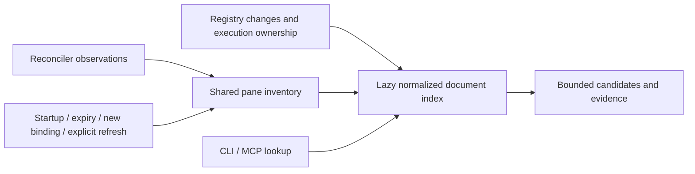

# Search agent records

## Find a current agent location

For “where is the agent working on this?”, start with the local live lookup:

```sh
muxa agent find 'CAL-8226' --json
muxa agent find '화자 분리' --limit 5 --json
muxa agent find 'AGENT_SESSION_ID' --json
```

MCP callers use `muxa_agent_find(query="CAL-8226")`. All whitespace-separated
keywords must match, case-insensitively, across workspace/window names, paths,
alias, titles, recap and latest prompt/response. Extract a few keywords from a
natural-language question; try alternate spellings if needed. Results prefer
location/title matches over incidental message mentions and return at most 10
candidates by default (maximum 50), with up to three 200-character excerpts.
`total` and `has_more` distinguish an empty result from a truncated list.
A query containing only a known agent session ID (or its prefix of at least
eight characters) resolves identity directly, ignoring mentions in other
agents’ transcripts. An unknown full UUID never falls back to transcript text.

Each candidate includes the exact host, socket, session, window and pane key,
agent session ID, provider and observed state. Grouped views are folded through
the canonical topology. Stopped and unassigned records never receive a guessed
live location. Ask ownership is tagged on the registry row when its hook or
structured provider session ID first arrives. A pending execution gate prevents
shared-server hooks from being assigned by cwd before that ID is known. The tag
is persisted independently of Ask history, so clearing/evicting history and
restarting the daemon preserve it. Ask-owned children are stopped when the run
ends. Explicit interactive resume process evidence, a trusted interactive hook,
or a fresh interactive prompt confirmed on the pane clears the tag; cwd alone
cannot promote it. If the conversation already has a trusted interactive pane,
a headless follow-up preserves that binding and does not replace its live
metadata with Ask events.
Matches among unassigned rows are counted in `unlocated_matches`; no pane is
invented for them. These are keyword candidates, not proof of ownership or
completion. Use `--exclude-session ID` (MCP `exclude_sessions`) to remove an
investigating conversation that merely repeats the question.

The lookup runs in the daemon, using its configured backend set rather than
the CLI/MCP process environment. CLI and MCP each send one `agent_find` IPC
request. An older daemon must be updated; there is no environment-dependent
local fallback. Remote Fleet hosts still require a separate Fleet query.

### Shared directory and freshness



The reconciler publishes the observations it already collected after completing
reconciliation/rebinding. Repeated and concurrent lookups reuse this inventory
and an immutable search projection; they do not start another background scan
loop. Registry change signals invalidate the projection lazily, and only
one request performs a demand refresh/build at a time. Text is redacted before
normalization and matching, so sensitive values are neither searchable nor
retained in the normalized document cache. Query text and result lists are not
cached. All derived state is memory-only and starts empty after daemon restart.

The default inventory maximum age is the configured reconciliation interval
plus two seconds (32 seconds with the default settings); a standalone server or
disabled reconciler uses two seconds. `freshness` reports the actual observation
time, age, configured bound and whether the document index was reused. Window
changes performed through Muxa lifecycle commands, MCP or Watch invalidate the
inventory immediately after the mutation; the following lookup refreshes it.
External multiplexer changes are bounded by the observation age. Registry
changes update agent text/state independently. A new or moved live binding
missing from inventory triggers one demand scan per newly missing binding.

Use `muxa agent find 'TASK_KEYWORDS' --refresh --json` (MCP `refresh=true`) when
an immediate observation is needed. Startup, expired data and explicit refresh
all use the same collection path. Overlapping force requests share an in-flight
demand observation; a later sequential force request performs a new one. A late
reconciler publish does not count as that demand observation. Mutation invalidation
keeps a monotonic floor so an older in-flight scan cannot make stale data fresh.
Failed/partial observations replace older
views with the currently observed subset and warnings; they never silently
keep an old pane looking current. A slow earlier scan cannot overwrite a newer
observation. Verify the returned agent session ID and endpoint before any
control action; a cached location does not authorize one.

If a task has disappeared from live metadata, use historical search below,
then look up the resulting agent session ID. An empty live result does not mean
the historical work never happened.

New `muxa ask` conversations using Claude, Codex or Gemini are guided to this
lookup first. Existing conversations retain their original guidance; start with
`muxa ask --new 'CAL-8226 작업하던 에이전트 위치 찾아줘'` after updating muxad.
Direct API providers do not have shell/MCP workspace tools; this change does not
give them live workspace access.

## Search historical evidence

`muxa agent search` and MCP `muxa_agent_search` search local Claude Code and Codex
transcripts, including sessions that have ended or started before the requested
day. `muxa agent read` / `muxa_agent_read` read surrounding events and paired tool
calls/results. They do not require a running daemon, contact a model, or query
MinIO/GitHub/other services mentioned in a transcript.

```sh
muxa agent search '2026.10.22 11:54 KST에 callabo-internal 버킷을 우리가 만들었는지' --json
muxa agent read EVENT_ID --before 5 --after 10 --json
```

## Natural-language retrieval

Questions in Korean or English are converted into a visible search plan:
distinctive keywords/identifiers plus a small vocabulary of alternate creation,
deletion, upload, deployment and storage terms. Local SQLite FTS retrieves
candidates; exact identifier matches rank higher. This is keyword expansion,
not an embedding search or a model-generated answer. Inspect `plan.terms` and
`expanded_terms` and use `--term` / `terms` to add project-specific vocabulary.

The planner recognizes `YYYY-MM-DD`, `YYYY.MM.DD`, `YYYY/MM/DD`, Korean
`YYYY년 MM월 DD일`, today/오늘, and yesterday/어제. A date and `HH:MM` or Korean
`오전/오후 HH시 [MM분|반]`, or English `H[:MM] AM/PM` mean a **±15 minute**
window (including hour-only expressions); a date alone means that day. Midnight
is `12 AM` and noon is `12 PM`. Version/identifier strings such as `v2026.10.1`
and `release-2026-10-22` remain keywords rather than date filters.
Timezone defaults to UTC. Specify KST in the question or `--timezone KST`
(`Asia/Seoul` and explicit `±HH:MM` offsets also work). The returned `plan.from`
and `plan.to` show the actual interpretation. Other natural-language dates and
date ranges are not interpreted: use explicit RFC3339 `--from` / `--to` to
override the planner. `from` is inclusive, `to` exclusive.
Questions containing multiple explicit dates do not receive an inferred time
filter. Multiple clocks with one date retain that whole day. Both cases add a
plan note asking the caller to supply the intended bounds.

```sh
# Time-only inspection finds commands whose text never mentions the bucket.
muxa agent search --from 2026-10-22T11:40:00+09:00 \
  --to 2026-10-22T12:10:00+09:00 --kind tool_call --json

# Follow a conversation, avoiding the current investigation's copied evidence.
muxa agent search --session-id HISTORICAL_ID --exclude-session CURRENT_ID --json

# Broaden the vocabulary, or restrict the provider / exact recorded cwd.
muxa agent search '버킷 생성' --term create_bucket --term 'mc mb' \
  --provider codex --cwd /project --json
```

## Evidence and wider investigation

Every hit includes `event_id`, provider, historical `session_id`, cwd, event
timestamp, kind, original path, physical line and byte offset, matched terms,
and a bounded excerpt. Use `muxa_agent_read` before treating an excerpt as
evidence. Its `events` are in source order; `related` contains paired tool
events beyond the requested context. `is_error` is supplied only when the
provider recorded a structured error flag; success is never inferred from prose.
Tool arguments are decoded before rendering: commands retain actual newlines and
tabs, rather than JSON escape sequences that change searchable word boundaries.
Freeform orchestration code also gets a separate search view for escaped
newlines/tabs; displayed evidence and paths retain their original spelling.
Displayed text is normalized and redacted, not byte-for-byte source JSON. Pairing
is confined to the anchor's source file; moving a source cannot join it to stale
cached copies of that file.

1. Search the question and inspect the interpreted plan and coverage.
2. Read relevant hits with their surrounding requests and execution results.
3. Follow other event IDs or filter the historical session to expand context.
4. Search alternate terms and a wider time range. Try time-only retrieval when
   the command might invoke a script or build a resource name dynamically.
5. Separate user requests, assistant claims, actual invocations, and results.
   Pasted JSON stays user prose; it is not reparsed as a new tool execution.
6. State what the evidence supports and what remains unknown. No match alone
   does not prove that an action never happened or identify a human actor.

`read` limits context to at most 50 events on either side, 50 additional paired
events, and `max_chars` (default 24,000, maximum 64,000). Each event reports
`truncated`; follow its ID with `before=0`, `after=0` and `text_offset` to read
more. `next_text_offset` continues the anchor in Unicode characters. Indexed
event text itself is capped at 262,144 characters; a cap is reported in coverage.
`source_available` and `source_current` distinguish cached evidence from a
currently available, fully indexed source. `related_truncated` means additional
pairs were omitted. Search pagination uses `next_offset`; broad retrieval is
capped at 2,000 candidates, with a warning to narrow the query if reached.
`coverage.complete` describes source indexing, not exhaustive candidate retrieval;
`candidates_limited=true` prevents an exhaustive conclusion even when indexing is complete.

## Discovery, indexing, and limits

Default roots are `~/.claude/projects`, `~/.codex/sessions` and
`~/.codex/archived_sessions`, with additional roots from `CLAUDE_CONFIG_DIR`,
`CODEX_HOME`, existing ASX account profiles, and explicit `--root` / `roots`.
Set `--only-roots` / `only_roots=true` to search only the explicitly supplied
files/directories, for a targeted investigation without indexing every home.
Canonical paths deduplicate aliases and symlinks. This node's files are searched;
there is no implicit remote-host lookup. Historical sessions predating Muxa are
included when their transcripts are present. Claude text/tool blocks and Codex
canonical `response_item` messages/calls/outputs are supported; Codex lifecycle
mirrors, token/coordination metadata, reasoning, binary content and compaction/API-request snapshots are not indexed.
Automatic instruction/skill text is omitted from results by default; opt in
with `include_instructions` / `--include-instructions`. An explicit
`kinds=["instruction"]` / `--kind instruction` also includes them.

The disposable index is `$XDG_DATA_HOME/muxa/agent-records-v2.sqlite` (the platform
data directory when XDG is unset). It is owner-only on Unix. Provider files are
never modified. On first use, the previous v1 derived index and its SQLite sidecar
files are retired because they could contain text cached before the redaction
fix; old event IDs require a new search. Incompatible cache schemas are rebuilt
and retired cache pages are purged when the new version opens them. Structured
credential fields are masked before rendering. Known credential assignments, HTTP authentication schemes,
escaped JSON keys, HTTP API-key headers, URL credentials, MySQL password
arguments, environment name/value pairs, common token/private-key patterns and
AWS presigned query strings are redacted before caching/output; this is best-effort redaction, not a guarantee
that arbitrary transcript text contains no secrets. The index remains private
conversation data and can be deleted to rebuild it.

Indexing resumes from saved JSONL byte/line positions and 64 KiB chunk hashes.
When source metadata changes, the complete cached prefix is verified before
reusing it. Only a detected mismatch or shrink discards the cached generation.
Verification is additional I/O, independent of the new-record byte budget, so
growing files can continue past a prefix larger than that budget. A verification
timeout preserves the checkpoint and events with incomplete coverage. Verification
still rereads the prefix after each change; slow storage may require narrower roots.
Unix stamps include inode and change time. Least recently attempted sources are
processed first so one growing session cannot consume every call before its peers.
Vanished sources are retired without deleting valid sources outside selected
roots. Writers acquire an immediate SQLite transaction before reading checkpoints;
WAL lets concurrent readers retain their snapshot. A writer lock can wait up to
30 seconds before an explicit error/gap is returned.
Context reads use one database snapshot for the anchor, neighbors and tool pairs.

Each call processes `max_index_bytes` of new source data (default 128 MiB, maximum
1 GiB), rounded up to a physical record. `coverage.index_bytes` reports these reads;
`coverage.bytes_read` additionally includes prefix verification and the partial
64 KiB checkpoint block. Total I/O can exceed the new-data byte budget. Approximately
12 seconds bound discovery/indexing (apart from lock and filesystem waits). Discovery
skips provider `tool-results` artifact directories and caps at 250,000 entries
and 128 levels; exceeding them reports incomplete coverage and asks for narrower roots. A growing source is read only through its
captured size. Large histories need repeated calls;
the first results may cover only part of the available records.

`coverage` reports roots, discovered/current/failed files, bytes processed,
malformed/oversized lines, unsupported records, truncated events, and untimed
events. `complete=false` means a negative result is inconclusive. Repeat to
continue budget-limited indexing; parse/read gaps remain explicit. Known metadata,
reasoning and binary blocks are explicitly excluded; unknown nested payload/block
variants count as unsupported instead of claiming complete coverage. Known PR/frame
links, cost state and review/patch lifecycle mirrors are explicitly excluded;
unhandled content such as a web-search payload still reports a gap. Records with
missing/invalid timestamps cannot satisfy a time filter. A growing partial last
JSONL record is retried rather than marked malformed. Lines larger than 8 MiB
are skipped with an explicit gap count. No provider format guarantees that all
human actions, remote sessions, or deleted records are represented.

## MCP

The tools are advertised by `muxa mcp` alongside the existing live-agent tools.
After installing the new CLI, reconnect/reload MCP as appropriate for the host
to discover them. See [MCP setup](MCP.md).

```json
{
  "query": "Who created the callabo-internal bucket?",
  "from": "2026-10-22T11:40:00+09:00",
  "to": "2026-10-22T12:10:00+09:00",
  "exclude_session_ids": ["CURRENT_SESSION_ID"],
  "limit": 20
}
```

### Resolved Claude built-in dialogs

Some Claude built-in commands resolve an input dialog without emitting a model
turn Stop or tool hook. A last `NeedsInput` notification can then outlive its UI.
For a live Claude row waiting on the known auto-mode setup proposal notification,
screen detection may recover Idle
only after two normal empty-composer observations with separators and a normal
mode footer. Running and selection/cancel affordances veto recovery. Other notification
messages, including nonmodal review approvals, are not candidates. A new hook,
move, process replacement or active rate limit vetoes the compare-and-set.
Recovery clears the resolved notification and emits a state transition without
counting a new model action or declaring a collaboration request complete.
